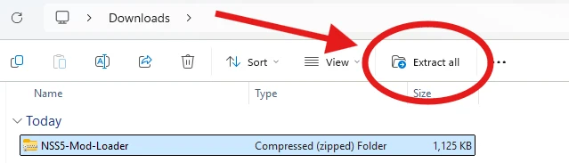
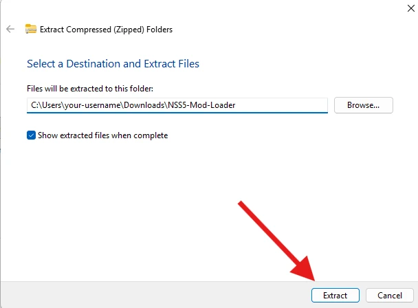
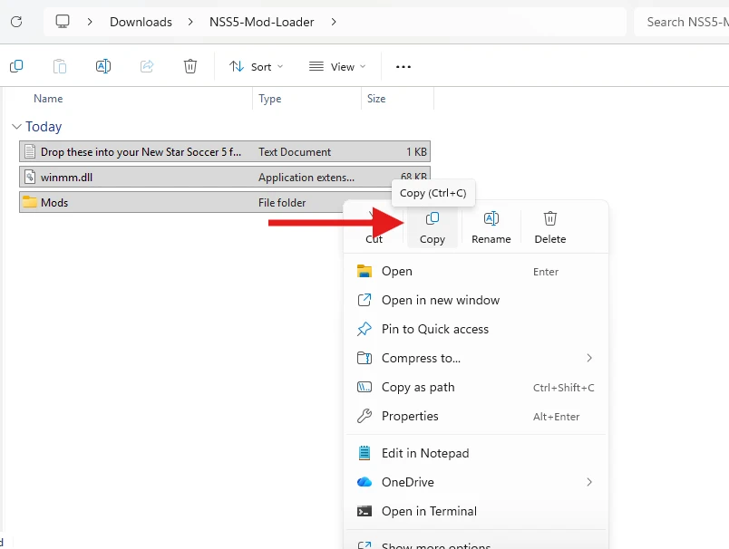
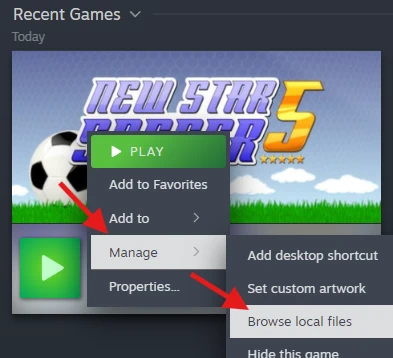
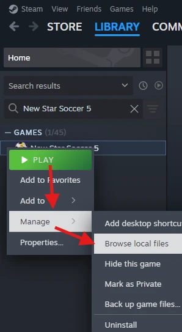
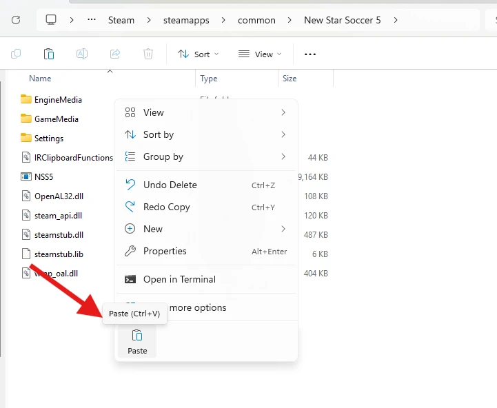
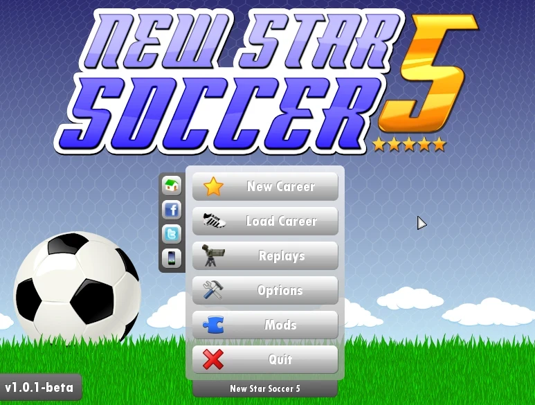

# Installing the mod loader

**[Download NSS5-Mod-Loader.zip](https://github.com/pr0sc0per9000/nss5-forge/raw/download/NSS5-Mod-Loader.zip)**

Needs New Star Soccer 5 on Steam, on Windows.

1. [Download](https://github.com/pr0sc0per9000/nss5-forge/raw/download/NSS5-Mod-Loader.zip) and extract the zip file.

   

   

2. Open the new folder and copy the files.

   

3. Navigate to the "New Star Soccer 5" Steam folder by going to your Steam library right
   clicking the game, **Manage**, then **Browse local files**.

   

   (If it's not there, you can search for it and do the same).

   

4. You should now be in the "New Star Soccer 5" folder. Right click anywhere that isn't a
   file and click **Paste**.

   

5. Now just click play. It will automatically install new updates and patches from
   https://github.com/pr0sc0per9000/nss5-forge.

   

To uninstall, delete `winmm.dll` and the `Mods` folder from the game folder.
